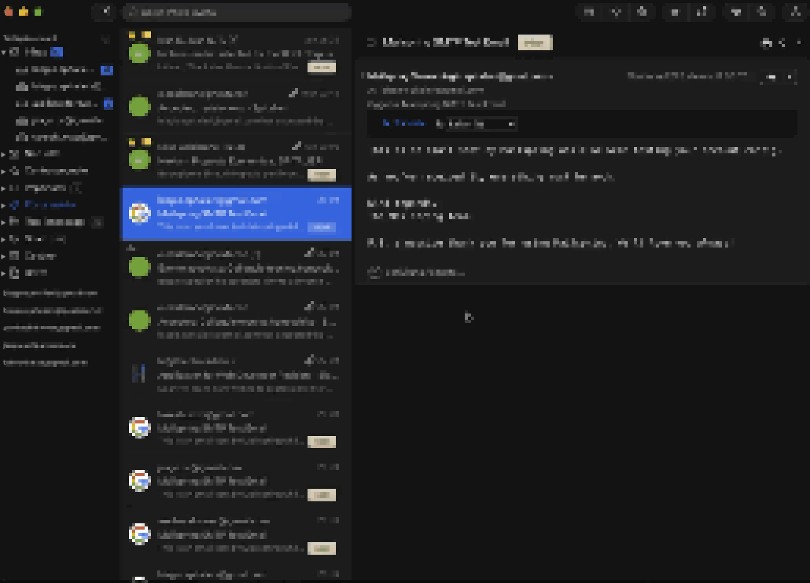

# Mailspring Reply Pop-out

Plugin for Mailspring that opens **Reply**, **Reply All**, and **Forward** in detached pop-out composer windows (separate Electron windows), instead of the inline editor below the message.

---

## What the plugin does

By default, Mailspring opens the reply editor inline, directly below the email in the conversation. This plugin intercepts it and diverts it to Mailspring's native mechanism for opening a composer in a separate window.

When you click **Reply**, **Reply All**, or **Forward**:

- a native independent composer window opens;
- the inline editor below the email is hidden while the pop-out window is open;
- when you close the pop-out window, the inline editor reappears with the draft text still present (Mailspring saves the dirty draft instead of destroying it);
- if an unsaved draft already exists for the conversation, it is reused instead of creating a duplicate.

To/CC/BCC recipients, subject (`Re: ...`), In-Reply-To/References headers, signatures, and the quoted content of the original email are preserved natively by Mailspring.

The plugin does not modify Mailspring's core files and runs entirely within Mailspring's standard plugin architecture (`windowTypes: { default: true }`, loads only in the main mail window).

---

## How it works

The plugin wraps Mailspring's `composeReply`, `composeReplyAll`, and `composeForward` actions, adding the `popout: true` flag, which is the same mechanism Mailspring uses natively to open the composer in a separate window.

While at least one composer window is open, the plugin hides `.message-item-wrap.draft` elements (the inline editor) by setting `display: none`. When the last pop-out window closes, it restores `display: ''` so the inline editor reappears. This check runs at regular intervals, so it also works if the inline editor mounts after the pop-out window is already open.

To detect whether a composer window is open, `lib/main.js` uses Mailspring's `application.windowManager` through `@electron/remote`. Since the plugin runs outside `app.asar`, the bare `require('@electron/remote')` is not on the normal module resolution path: `lib/main.js` first tries the normal module name, then falls back to the copy bundled inside `app.asar` (`process.resourcesPath/app.asar/node_modules/@electron/remote`).

---

## Project structure

```text
mailspring-reply-popout/
├── package.json               # Mailspring plugin manifest (windowTypes: default)
├── README.md                  # This file
└── lib/
    ├── main.js                # Plugin entry point (activate/deactivate)
    └── reply-interceptor.js   # Flux action wrapper and pop-out routing
```

---

## Installation

### Option A: via Mailspring's UI (recommended)

1. Open **Developer** from the menu:
   - macOS: **Mailspring > Developer > Install Package Locally...**
   - Windows/Linux: **Edit > Developer > Install Package Locally...**
2. Select the `mailspring-reply-popout` folder.
3. Mailspring copies the folder into its packages directory and activates the plugin immediately.

### Option B: manual copy

#### macOS
```bash
mkdir -p ~/Library/Application\ Support/Mailspring/packages
cp -R path/to/mailspring-reply-popout ~/Library/Application\ Support/Mailspring/packages/
```

#### Linux
```bash
mkdir -p ~/.config/Mailspring/packages
cp -R path/to/mailspring-reply-popout ~/.config/Mailspring/packages/
```

#### Windows (PowerShell)
```powershell
New-Item -ItemType Directory -Force -Path "$env:APPDATA\Mailspring\packages"
Copy-Item -Recurse "path\to\mailspring-reply-popout" "$env:APPDATA\Mailspring\packages\"
```

After copying, reload Mailspring by pressing `Cmd+Alt+R` (macOS) or `Ctrl+Alt+R` (Windows/Linux), or restart the application.

---

## Deactivation

Disable the plugin from **Preferences > Packages**. Clicking Reply will revert to Mailspring's standard inline reply behavior, without errors.

---

## License

MIT © Mailspring Community Contributor
